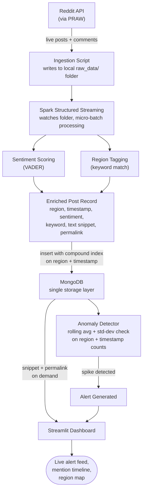

# Disaster Early-Warning System from Social Media Chatter

A real-time pipeline that monitors social media for disaster-related keywords, detects abnormal spikes in mentions per region, and raises early warning alerts — before official news catches up.

Built as a semester project for **Big Data Programming Tools**, using Spark Streaming and MongoDB together as a lean, real-time detection pipeline — no Hadoop cluster required.

## Core Idea

People post about floods, earthquakes, and wildfires on social media *before* agencies confirm them. This system watches that chatter, counts mentions per region in near real-time, and flags a sudden spike as a potential early warning.

## System Flow



**Reading the diagram:** Reddit posts flow in continuously → Spark processes them as they arrive, scoring sentiment and tagging region → each post becomes one enriched document stored in MongoDB (indexed for fast querying) → the anomaly detector queries MongoDB directly for mention counts per region → confirmed spikes and post snippets both surface on the dashboard.

## Tech Stack & Why Each Tool Is There

| Tool | Used For | Why This Tool |
|---|---|---|
| **PRAW** | Pulling live posts from Reddit | Free, reliable API — unlike Twitter/X's restricted free tier |
| **Apache Spark (Structured Streaming)** | Processing posts as they arrive, in micro-batches | Purpose-built for continuous, near-real-time data processing |
| **MongoDB** | Storing enriched post records; fast region + time-window queries | A compound index on `region + timestamp` gives fast range-scans without a second database — simpler architecture, same performance for this scale |
| **VADER Sentiment** | Scoring urgency/sentiment per post | Lightweight, free, no GPU needed |
| **Streamlit** | Dashboard — alerts, timeline, map | Fast to build, pairs well with Python backend logic |

## MongoDB Document Schema

```json
{
  "region": "Assam",
  "timestamp": "2026-09-12T14:32:00Z",
  "sentiment_score": -0.72,
  "keyword_matched": "flood",
  "text_snippet": "Water levels rising fast near...",
  "permalink": "https://reddit.com/r/india/..."
}
```

**Compound index:** `{ region: 1, timestamp: -1 }` — this is what makes "count mentions in the last 10 minutes" queries fast, doing the job a second indexed database would otherwise handle.

Only a short snippet (not the full post) and a link back to the source are stored — enough to show real evidence on the dashboard without hoarding full post bodies.

## Quick Start

Requirements: macOS/Linux, Python 3.11, Java 11+, MongoDB Community running locally.

```bash
make setup                          # venv + dependencies
brew services start mongodb-community
make test                           # 38 tests, incl. an end-to-end Spark -> MongoDB run
make run                            # Spark job + detector + dashboard -> http://localhost:8501
```

### Demo (no Reddit credentials needed)

Natural disasters are hard to schedule, so a simulator writes records in exactly the same format as the live Reddit ingester.
With `make run` going in one terminal, use another:

```bash
make baseline                       # 60 min of quiet background chatter across regions
make spike REGION=Assam KW=flood N=40   # a burst -> alert on the dashboard within seconds
make spike REGION=Kerala KW=earthquake
make reset                          # wipe everything for a clean run
```

Single hand-written posts: `python -m ingestion.simulate one --region Nepal --keyword earthquake --text "Big quake in Kathmandu"`.
Alerts can also be tested by inserting documents straight into MongoDB with `mongosh`; nothing is ever posted to Reddit.

### Live Reddit mode

Create a "script" app at reddit.com/prefs/apps (Reddit now requires registering for API access first), copy `.env.example` to `.env`, fill in the credentials, then:

```bash
USE_REDDIT=1 make run               # or: make ingest
```

## Project Layout

```
common/      config, MongoDB helper + indexes, keyword matching, region dictionary (names + coordinates)
ingestion/   ingest.py (PRAW poller)   simulate.py (fake-data injector)
streaming/   stream_job.py (Spark Structured Streaming)   enrich.py (region + VADER + snippet)
detector/    detector.py (sliding-window spike detector)
dashboard/   app.py (Streamlit)   data.py (queries)
scripts/     run_all.sh   demo.sh        tests/  unit + end-to-end tests
```

## How Each Stage Works

- **Ingestion** polls r/india, r/news, r/worldnews, r/weather, r/NaturalDisasters every 60 s, matches disaster keywords with word boundaries (so "floodlights" is ignored), skips IDs it has already seen, and writes one JSON-lines batch per poll. Files are written to a hidden temp name and renamed, so Spark never reads half a file. Rate limits and API errors trigger backoff instead of a crash.
- **Spark job** watches `raw_data/` in 5 s micro-batches (`local[*]`), tags a region from a dictionary of region and place names, scores VADER sentiment, trims the text to a 200-character snippet, and upserts into MongoDB by Reddit ID inside `foreachBatch`. Together with Spark's checkpoint, restarts and replays never create duplicates. Malformed lines are dropped.
- **Detector** counts mentions per region in a sliding window (default 5 min) and compares with the previous 12 windows. It alerts when `count >= max(mean + 3 * max(std, 1), 5)`. The std floor and minimum count stop quiet regions from firing on two or three posts. Windows slide rather than align to the clock, so a burst is never split across a bucket boundary. An ongoing incident updates one alert (peak count, z-score, severity `warning`/`critical`) instead of creating duplicates.
- **Dashboard** auto-refreshes: KPIs, alert feed, per-region mention timeline, map (alerting regions in red), and the latest matching posts with links back to the source.

## Tuning

`python -m detector.detector --window-minutes 5 --baseline-windows 12 --k 3 --min-count 5` (lower `--k` for more sensitivity). Look-back, bucket size, region and disaster-type filters live in the dashboard sidebar.

## Scaling Story

The system filters at the source (specific subreddits and keywords) so volume stays small, then scales by adding compute: Spark moves from `local[*]` to a cluster by changing one config line (`.master(...)`), and MongoDB scales out through sharding on `region` (the leading field of the compound index). The detector's work is a single indexed aggregation, so it also stays fast as data grows.

## Design Decisions

- **MongoDB only (no HBase).** A compound index on `{region: 1, timestamp: -1}` serves the "mentions in the last N minutes" queries at this scale, without a second database.
- **No HDFS.** The raw backup is a local `raw_data/` folder, which is also Spark's streaming source.
- **Reddit over Twitter/X**, whose free tier no longer allows reading posts.
- **Store only an enriched record** (region, timestamp, sentiment, keyword, 200-character snippet, permalink), not full post bodies.

## Known Limitations

- Region tagging is keyword-based, so posts that name no place are tagged `Unknown` and excluded from alerts, and ambiguous place names can be mis-tagged.
- VADER is a general-purpose sentiment model: it reads words like "help" as positive, so sentiment is shown as supporting context and is not used for alerting.
- Reddit skews towards certain countries and languages (English), and Reddit chatter is not verified information, so an alert means "unusual chatter", not "confirmed disaster".
- Live Reddit mode is unit-tested against a mocked client but has not been run against the real API yet.

## What This Project Demonstrates

- Real-time stream processing with Spark Structured Streaming (file source, micro-batches, checkpointing, idempotent sinks)
- MongoDB schema and compound-index design for fast time-windowed queries, verified with `explain()`
- Architectural judgment: evaluating a two-database design and simplifying to one after confirming it meets the performance requirement
- A statistically grounded anomaly detector with tested edge cases (quiet regions, noisy baselines, ongoing incidents)
- End-to-end pipeline thinking: ingestion, processing, storage, detection and visualisation, with automated tests
